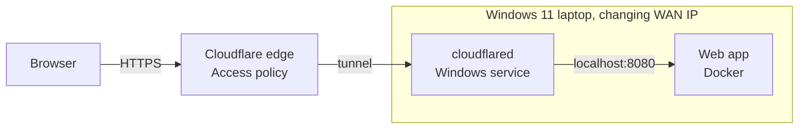

# Cloudflare Tunnel for a Local Web App (Windows 11)

I run a small web app in Docker on my Windows 11 laptop and needed to reach it from outside. The laptop moves between home Wi-Fi, the office and phone tethering, so port forwarding and a static IP were never an option.

This repo documents the setup I ended up with: `cloudflared` running as a Windows service, one published hostname, and Cloudflare Access in front of it with email one-time PIN login. The router has no open ports, and the public URL keeps working when the laptop changes networks.

## Contents

1. [How it works](#how-it-works)
2. [Requirements](#requirements)
3. [Create the tunnel](#1-create-the-tunnel)
4. [Install the connector](#2-install-the-connector-on-windows)
5. [Publish the app](#3-publish-the-app)
6. [Restrict access](#4-restrict-access-with-email-otp)
7. [Enforce JWT validation](#5-enforce-access-jwt-validation)
8. [Keep it running](#6-keep-it-running)
9. [Checks](#checks)
10. [Troubleshooting](#troubleshooting)
11. [Security notes](#security-notes)

## How it works



`cloudflared` opens an outbound connection from the laptop to Cloudflare and keeps it open. Requests for `app.example.com` hit Cloudflare first, which checks the Access policy, then travel back down that connection to `cloudflared`, which forwards them to the container on port 8080.

The laptop only makes outbound connections, so its public IP doesn't matter. After a network change, `cloudflared` reconnects on its own in a few seconds and the hostname stays the same.

## Requirements

- A domain using Cloudflare nameservers (the free plan works)
- Cloudflare Zero Trust enabled (free tier, `one.dash.cloudflare.com`)
- Docker Desktop with the app published on port 8080
- Admin rights on the Windows machine
- `curl http://localhost:8080` returns the app on the host

The tunnel token used below gives control of the connector. Keep it in a password manager and out of the repo, screenshots and issues. I use `<YOUR_TUNNEL_TOKEN>` as a placeholder.

## 1. Create the tunnel

1. In the Zero Trust dashboard, open **Networks > Tunnels > Create a tunnel**.
2. Pick **Cloudflared** as the connector type.
3. Give it a name (I used `windows-webapp`) and save.
4. The next screen shows install commands with the token (a long string starting with `eyJ`). Copy it.

The token stays the same for the life of the tunnel. You can view it again from the tunnel's **Configure** page or rotate it with **Refresh token**.

## 2. Install the connector on Windows

Run `cloudflared` as a service. If you start it with `cloudflared tunnel run` in a terminal, it stops when you close the window or the machine sleeps.

In an elevated PowerShell:

```powershell
winget install --id Cloudflare.cloudflared
```

Open a new elevated PowerShell so `PATH` updates, then:

```powershell
cloudflared --version
cloudflared service install <YOUR_TUNNEL_TOKEN>
Get-Service cloudflared
```

`Get-Service` should show `Running`, and the dashboard should list the tunnel as **Healthy**.

To reinstall, run `cloudflared service uninstall` first. It errors if no service exists; ignore that.

If you run `cloudflared` in a container instead of on the host, `localhost` points at that container. Use `http://host.docker.internal:8080` as the target in that case.

## 3. Publish the app

Open the tunnel, go to **Published application routes** and add a route:

| Field | Value |
|---|---|
| Subdomain | `app` |
| Domain | your domain |
| Path | empty |
| Type | `HTTP` |
| URL | `localhost:8080` |

Cloudflare creates the proxied CNAME record for you.

Put `localhost:8080` in the URL field only. I first typed it into Path and got a 404, because the request fell through to the default `http_status:404` rule. An empty Path matches everything.

Open `https://app.example.com` in a private window. A 502 means the tunnel works but nothing answered on port 8080, so check the container.

## 4. Restrict access with email OTP

1. Go to **Access > Applications > Add an application > Self-hosted**.
2. Set the application domain to `app.example.com`.
3. Add a policy named `Authorized emails`, action **Allow**, and under **Include > Emails** list the addresses you want to let in.
4. Save.

Zero Trust accounts have One-Time PIN enabled by default, so you don't need to configure a login method. Visitors enter their email, receive a code, and get through only if their address is on the list.

## 5. Enforce Access JWT validation

With this on, `cloudflared` drops any request without a valid Access token. That closes the gap where someone reaches the tunnel without going through Access.

Turn it on after you confirm the email login works, or you will lock yourself out.

1. Edit the route under **Published application routes**.
2. Open **Origin request and connection settings**.
3. Enable **Enforce Access JWT validation** and select the application from step 4.
4. Save.

## 6. Keep it running

The service handles reconnects. Two more settings let the laptop host unattended.

Restart the container automatically:

```powershell
docker update --restart unless-stopped <CONTAINER_NAME>
```

or in Compose:

```yaml
services:
  webapp:
    restart: unless-stopped
    ports:
      - "8080:8080"
```

Stop the laptop from sleeping, including with the lid closed (elevated PowerShell):

```powershell
powercfg /change standby-timeout-ac 0
powercfg /change standby-timeout-dc 0

# Lid close action: 0 = do nothing
powercfg /setacvalueindex SCHEME_CURRENT SUB_BUTTONS LIDACTION 0
powercfg /setdcvalueindex SCHEME_CURRENT SUB_BUTTONS LIDACTION 0
powercfg /setactive SCHEME_CURRENT
```

You can set the same options in **Settings > System > Power** and in the classic Power Options panel.

## Checks

| Check | How | Expected |
|---|---|---|
| Service | `Get-Service cloudflared` | `Running` |
| Tunnel | Dashboard > Tunnels | `Healthy` |
| App on host | `curl http://localhost:8080` | HTML |
| Public URL | `https://app.example.com` in a private window | Email prompt, then the app |
| Network change | Switch Wi-Fi to tethering, wait 30 s, reload | App loads |

## Troubleshooting

| Symptom | Cause | Fix |
|---|---|---|
| 404 | `localhost:8080` entered in Path or Proxy Type | Clear those fields, keep it only in URL |
| 502 / 521 | Nothing listening on 8080 | Check the container and its restart policy |
| 530 or no DNS | CNAME missing or not proxied | Turn on the orange cloud for the record |
| Drops after a network change | Running `cloudflared tunnel run` in a terminal | Install it as a service |
| Page loads without CSS/JS | App checks the `Host` header | Set HTTP Host Header to `localhost:8080` in origin settings |
| Service install fails | Old service still registered | `cloudflared service uninstall`, then install again |

Logs are in **Event Viewer > Windows Logs > Application** under the `cloudflared` source. `cloudflared tunnel info <name>` shows connector status.

## Security notes

The tunnel forwards only the routes you define. With one route to `localhost:8080` and the 404 catch-all, no other port or file on the machine is reachable through it, and a scan of the WAN IP finds nothing open. Access requires the email code, and JWT validation stops anyone from skipping that step.

The remaining risk sits in three places:

- **The app.** Anyone on the allow list can do whatever the app allows. If it can read files or run commands, so can they.
- **The allow list.** Keep it short.
- **The token.** Whoever holds it can run a connector for this tunnel. Rotate it if it leaks.

## Author

Gustavo Carvalho, Infrastructure & Cloud Operations
